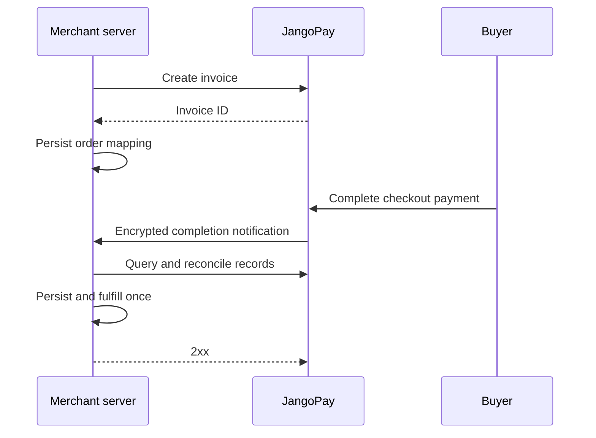

<p align="center"></p>

<p align="center"><a href="README.zh-CN.md">简体中文</a> · <a href="https://www.jangopay.org/">Website</a> · <a href="https://app.jangopay.org/">Console</a> · <a href="https://doc.jangopay.org/">Developer docs</a></p>

# JangoPay · Stablecoin Payment API

Connect websites, stores, SaaS and online services to stablecoin and cryptocurrency payments. Start with payment links, or use server-side APIs to create invoices, query records and receive completion notifications.

## Contents

- [Quick start](#quick-start)
- [API integration](#api-integration)
- [Create an invoice](#create-an-invoice)
- [Queries and payment confirmation](#queries-and-payment-confirmation)
- [Webhooks](#webhooks)
- [Platform integrations](#platform-integrations)
- [FAQ](#faq)
- [Contact](#contact)

## Quick start

1. Sign in to [JangoPay Console](https://app.jangopay.org/) and open Developer settings → API keys.
2. Configure two-factor authentication as required and create a Key with invoice creation and any needed read permissions.
3. Save the Key in your server environment. The full Key is shown only once.
4. Exchange the Key for an external access token, create an invoice and persist the merchant order mapping.
5. In Developer settings → Callback configuration, set a public callback URL and RSA public key. Keep the matching private key on your server.
6. Test collection, notification handling, duplicate delivery and reconciliation.

For a no-code launch, create a payment link in Console. Available assets, networks and fees follow current product and account settings.

## API integration

Base URL: `https://api.jangopay.org`. Make requests from your server.

| Method | Path | Purpose |
| :--- | :--- | :--- |
| POST | `/api/v1/auth/apikey/token` | Exchange an API Key for tokens |
| POST | `/api/v1/auth/apikey/token/refresh` | Rotate external tokens |
| GET | `/api/v1/invoice/payment-assets` | List payment assets |
| POST | `/api/v1/invoice/create` | Create an invoice |
| GET | `/api/v1/invoice/list` | List merchant invoices |
| GET | `/api/v1/invoice/{invoiceId}` | Get invoice details |
| GET | `/api/v1/invoice/transaction/{txnId}` | Get transaction details |

Use `Authorization: Basic JangoPay_xxx` for token issuance. JangoPay expects the API Key directly after Basic; do not Base64-encode a username/password pair. Business requests use `Authorization: Bearer <accessToken>`.

```bash
# Configure JANGOPAY_API_KEY in your server environment first.
curl --fail-with-body --request POST \
  https://api.jangopay.org/api/v1/auth/apikey/token \
  --header "Authorization: Basic $JANGOPAY_API_KEY" \
  --header "Content-Type: application/json" \
  --data '{}'
```

Tokens are returned in `data.accessToken` and `data.refreshToken`. `data.expiresIn` and `data.refreshExpiresIn` are Unix-millisecond expiry timestamps, not durations in seconds. A successful refresh invalidates the previous refresh token; coordinate concurrent refreshes.

## Create an invoice

Store the issued token in the server-side `JANGOPAY_ACCESS_TOKEN` environment variable.

```bash
curl --fail-with-body --request POST \
  https://api.jangopay.org/api/v1/invoice/create \
  --header "Authorization: Bearer $JANGOPAY_ACCESS_TOKEN" \
  --header "Content-Type: application/json" \
  --data '{
    "currencyCode": "USD",
    "amount": "10.00",
    "orderId": "ORDER-1001",
    "description": "Premium plan",
    "allowedCurrency": ["USDT:tron"],
    "coverPct": 100,
    "mixPay": false,
    "autoToU": false,
    "autoWithdraw": false,
    "feePayByUser": false
  }'
```

| Field | Meaning |
| :--- | :--- |
| `currencyCode` | Required; currently USD |
| `amount` | Required pricing amount, expressed as a string |
| `orderId` | Merchant order ID; not unique or an idempotency key |
| `allowedCurrency` | Enabled asset/network pairs, such as USDT:tron |
| `expiresAt` | Optional RFC3339 expiry; defaults to 24 hours after creation |
| `coverPct` | 1–100; defaults to 100 |
| `returnUrl` | Optional merchant return page |
| `extraInfo` | Optional simple string-to-string metadata |

Use `invoice.invoiceId` from the successful response for order mapping and queries. Checkout determines the payment asset, on-chain amount and receive address later. Follow the [official integration guide](https://doc.jangopay.org/integration-guide) for checkout integration.

After an ambiguous creation timeout, reconcile existing records before creating again. Persist the merchant order/invoice mapping.

## Queries and payment confirmation

```bash
curl --fail-with-body \
  "https://api.jangopay.org/api/v1/invoice/list?page=1&pageSize=20" \
  --header "Authorization: Bearer $JANGOPAY_ACCESS_TOKEN"
```

The list business response includes `success`, `invoices`, `total` and `totalPages`. Authentication responses use `code`, `msg` and `data`; handle the two response shapes separately.

Pending, confirming, failed and expired records should not trigger fulfillment. Process server-side completion notifications, query invoices/transactions when needed, and match the local order and amounts before delivery. A browser return is not proof of payment.



## Webhooks

Payment completion uses `payment.completed`; payout completion notifications are also available. Notifications use **RSA-OAEP-SHA256 + AES-256-GCM**, not an EPay MD5 signature.

Configure the public key in Console and retain its paired private key on your server. Decrypt the notification and reconcile the mapped order, asset, transaction and amounts. There is no independent `event_id` in the current payload: deduplicate by event type, invoice/payout ID and transaction hash, and ensure each business order is fulfilled once. Return any 2xx only after successful processing and persistence. The official guide documents up to five retries on failure.

[Webhook guide](docs/en/webhooks.md) · [中文](docs/zh-CN/webhooks.md)

## Platform integrations

| Integration | Resource |
| :--- | :--- |
| Custom websites, stores and SaaS | [API Reference](https://doc.jangopay.org/api-reference) |
| Node.js / PHP / Python request examples | [jangopay-examples](https://github.com/jangopay/jangopay-examples) |
| Server SDKs | [Official SDK guide](https://doc.jangopay.org/integration-guide?section=sdk) |
| Dujiaoka 2.x | [Official integration and migration guide](https://doc.jangopay.org/integration-guide?section=dujiaoka) |

Customized Dujiaoka deployments require a reviewed merge. An EPay-compatible gateway requires separate implementation and testing; this repository does not claim that compatibility.

## FAQ

**Is a USD amount the same as the number of USDT tokens?** No. Invoice pricing uses USD; checkout determines the payment amount for the selected asset.

**Can I place an API Key in my website?** Keep it on your server. Provide only the necessary checkout display information to the frontend.

**Why are notifications repeated?** Network recovery and retries can repeat delivery. Use database constraints and order transitions to process each business action once.

**Can I fulfill after the buyer returns to my site?** Reconcile server-side completion notifications and payment records first.

**What happens to late payments?** The official guide explains that payments arriving after invoice expiry may enter exception-fund records and require reconciliation rather than reopening the original order.

## Further reading

[Product overview](docs/en/product-overview.md) · [Business scenarios](docs/en/business-scenarios.md) · [Launch checklist](docs/en/integration-checklist.md) · [Changelog](https://doc.jangopay.org/changelog)

## Contact

[Website](https://www.jangopay.org/) · [X](https://x.com/JangoPayGlobal) · [Telegram](https://t.me/jangopay) · [contact@jangopay.org](mailto:contact@jangopay.org)

API summary checked on 2026-10-12. Consult the [official API Reference](https://doc.jangopay.org/api-reference) and [integration guide](https://doc.jangopay.org/integration-guide) for the complete current contract.
