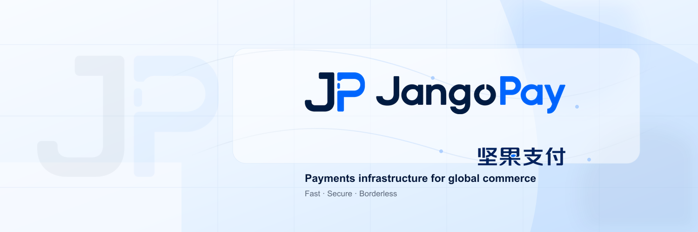
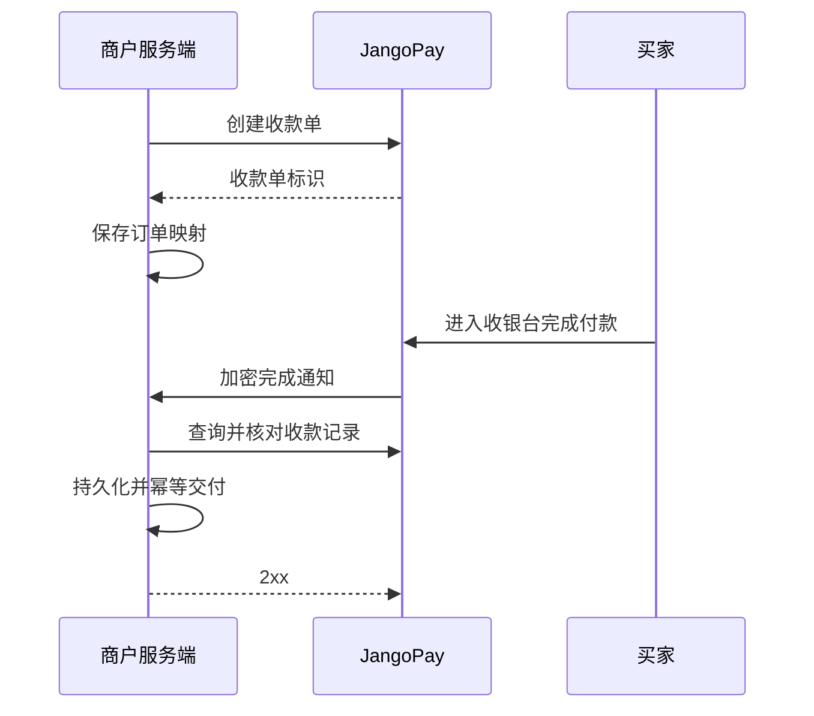

<p align="center"></p>

<p align="center"><a href="README.md">English</a> · <a href="https://www.jangopay.org/">官网</a> · <a href="https://app.jangopay.org/">商户控制台</a> · <a href="https://doc.jangopay.org/">开发文档</a></p>

# JangoPay 坚果支付 · 稳定币支付 API

为网站、商城、SaaS 和在线业务接入稳定币与加密货币支付。从收款链接开始，也可以通过服务端 API 创建收款单、查询订单并接收完成通知。

## 目录

- [快速开始](#快速开始)
- [API 接入](#api-接入)
- [创建收款单](#创建收款单)
- [查询与支付确认](#查询与支付确认)
- [Webhook](#webhook)
- [平台接入](#平台接入)
- [常见问题](#常见问题)
- [联系我们](#联系我们)

## 快速开始

1. 登录 [JangoPay Console](https://app.jangopay.org/)，进入「开发者设置 → API 密钥」。
2. 按控制台要求配置两步验证，创建具备「创建收款单」及所需查询权限的 API Key。
3. 将 Key 保存到服务端环境变量。完整 Key 仅在创建时显示一次。
4. 使用 Key 获取外部访问令牌，然后创建收款单并保存业务订单映射。
5. 在「开发者设置 → 回调配置」设置公网回调 URL 与 RSA 公钥，服务端保管对应私钥。
6. 完成收款、通知、重复投递和对账联调。

无需开发时，先在控制台创建收款链接。当前可用资产、网络和费用以正式产品与账户配置为准。

## API 接入

网关：`https://api.jangopay.org`。请求在服务端发起。

| 方法 | 路径 | 用途 |
| :--- | :--- | :--- |
| POST | `/api/v1/auth/apikey/token` | API Key 换取访问令牌 |
| POST | `/api/v1/auth/apikey/token/refresh` | 轮换外部访问令牌 |
| GET | `/api/v1/invoice/payment-assets` | 查询支付资产 |
| POST | `/api/v1/invoice/create` | 创建收款单 |
| GET | `/api/v1/invoice/list` | 查询商户收款单 |
| GET | `/api/v1/invoice/{invoiceId}` | 查询收款单详情 |
| GET | `/api/v1/invoice/transaction/{txnId}` | 查询交易详情 |

认证请求头为 `Authorization: Basic JangoPay_xxx`：这里按 JangoPay 契约直接使用 API Key，不是用户名密码的 Base64 编码。业务请求使用 `Authorization: Bearer <accessToken>`。

```bash
# JANGOPAY_API_KEY 已在服务端环境中配置
curl --fail-with-body --request POST \
  https://api.jangopay.org/api/v1/auth/apikey/token \
  --header "Authorization: Basic $JANGOPAY_API_KEY" \
  --header "Content-Type: application/json" \
  --data '{}'
```

令牌位于 `data.accessToken` 和 `data.refreshToken`。`data.expiresIn` 与 `data.refreshExpiresIn` 是毫秒级到期时间戳，不是有效秒数。刷新成功后旧刷新令牌失效，请协调并发刷新。

## 创建收款单

将取得的访问令牌保存到服务端 `JANGOPAY_ACCESS_TOKEN`。

```bash
curl --fail-with-body --request POST \
  https://api.jangopay.org/api/v1/invoice/create \
  --header "Authorization: Bearer $JANGOPAY_ACCESS_TOKEN" \
  --header "Content-Type: application/json" \
  --data '{
    "currencyCode": "USD",
    "amount": "10.00",
    "orderId": "ORDER-1001",
    "description": "Premium plan",
    "allowedCurrency": ["USDT:tron"],
    "coverPct": 100,
    "mixPay": false,
    "autoToU": false,
    "autoWithdraw": false,
    "feePayByUser": false
  }'
```

| 参数 | 说明 |
| :--- | :--- |
| `currencyCode` | 必填，当前为 USD |
| `amount` | 必填，以字符串传入计价金额 |
| `orderId` | 商户订单号；不是幂等键，不保证唯一 |
| `allowedCurrency` | 币种与链组合，如 USDT:tron；使用当前启用的资产 |
| `expiresAt` | 可选 RFC3339 过期时间；默认创建后 24 小时 |
| `coverPct` | 1–100，默认 100 |
| `returnUrl` | 可选，付款后返回商户页面 |
| `extraInfo` | 可选，简单字符串键值元数据 |

成功响应中的 `invoice.invoiceId` 用于查询与关联订单。付款资产、链上应付数量和地址在后续收银台流程中确定。收银台接入方式请按[官方集成指南](https://doc.jangopay.org/integration-guide)配置。

创建请求超时后先核对订单记录，不要盲目重复创建。服务端需要持久化订单与收款单映射。

## 查询与支付确认

```bash
curl --fail-with-body \
  "https://api.jangopay.org/api/v1/invoice/list?page=1&pageSize=20" \
  --header "Authorization: Bearer $JANGOPAY_ACCESS_TOKEN"
```

列表业务响应包含 `success`、`invoices`、`total` 和 `totalPages`；认证接口使用 `code`、`msg`、`data`，不要混用响应结构。

等待付款、确认中、部分付款及失败/过期均不应触发发货。`payment.completed` 表示一笔交易已结算，不代表收款单一定已付清。通过商户 API 确认 `invoice.status` 为 `paid`、对应 `transaction.status` 为 `settled`，再核对本地订单与金额并幂等交付。浏览器跳转不是付款凭证。



## Webhook

`payment.completed` 表示一笔付款交易已结算，另有转出完成通知。当前通知使用 **RSA-OAEP-SHA256 + AES-256-GCM**，不是易支付的 MD5 签名格式。

- 在 Console 配置回调公钥，配对私钥仅保存于商户服务器。
- 解密通知后核对订单映射、支付资产、交易和金额。
- 当前负载没有独立 `event_id`；`payment.completed` 按事件类型 + `txn_id` 去重，`payout.completed` 按事件类型 + `payout_id` 去重，同时保证同一业务订单只交付一次。
- 解密、持久化及业务处理成功后返回任意 2xx；失败会重试，官方文档说明最多 5 次。

[中文 Webhook 指南](docs/zh-CN/webhooks.md) · [English](docs/en/webhooks.md)

## 平台接入

| 方式 | 入口 |
| :--- | :--- |
| 自研网站、商城、SaaS | [API Reference](https://doc.jangopay.org/api-reference) |
| Node.js / PHP / Python 请求示例 | [jangopay-examples](https://github.com/jangopay/jangopay-examples) |
| 多语言 SDK | [官方 SDK 指南](https://doc.jangopay.org/integration-guide?section=sdk) |
| Dujiaoka 2.x 独角数卡 | [官方接入与迁移指南](https://doc.jangopay.org/integration-guide?section=dujiaoka) |

定制版独角数卡应按指南审查并合并差异。易支付兼容网关需单独适配与联调，本仓库没有发布其兼容性承诺。

## 常见问题

**USD 金额是否就是 USDT 数量？** 不是。订单按 USD 计价，付款数量由实际资产及收银台流程决定。

**API Key 可以放在网页里吗？** 应只存放在服务端；前端接收付款展示信息。

**为什么重复收到通知？** 网络恢复和重试可能导致重复投递；用数据库唯一约束及订单状态更新保证只处理一次。

**用户付款后返回网站，可以发货吗？** 应核对服务端完成通知及收款记录。

**收款单已过期但买家转账了怎么办？** 官方指南说明可能进入异常资金记录，需核对处理，不能自动恢复原订单。

## 更多资料

[产品概览](docs/zh-CN/product-overview.md) · [业务场景](docs/zh-CN/business-scenarios.md) · [上线检查](docs/zh-CN/integration-checklist.md) · [更新日志](https://doc.jangopay.org/changelog)

## 联系我们

[官网](https://www.jangopay.org/) · [X](https://x.com/JangoPayGlobal) · [Telegram](https://t.me/jangopay) · [contact@jangopay.org](mailto:contact@jangopay.org)

接口摘要核对日期：2026-10-12。完整参数与最新行为以[官方 API Reference](https://doc.jangopay.org/api-reference)及[集成指南](https://doc.jangopay.org/integration-guide)为准。
